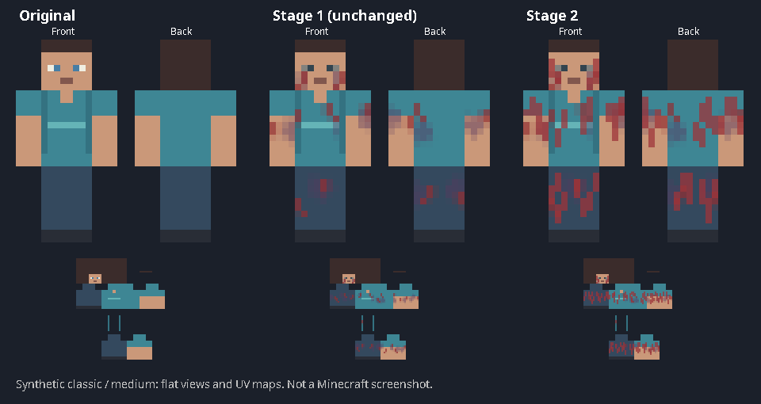
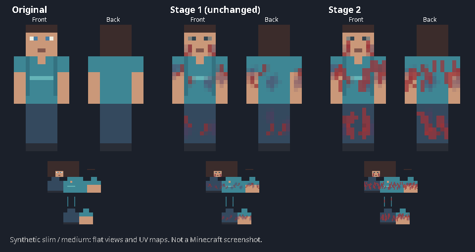

# InfectedMorph — Stages 1 and 2 (0.4.1-SNAPSHOT)

Standalone Minecraft plugin for **Purpur 26.2 / Java 25**, Maven, standard Java clients and optional LuckPerms.
The approved Stage 1 appearance is unchanged. Stage 2 adds a separate, more scratched original-skin variant
and faster ground movement. No ChunkVote dependency, client mods, custom models or resource packs.

**Java skin application uses MineSkin V2 and the existing Paper profile backend.** A valid environment API key
and `java-display.enabled: true` are required. Without them, commands generate previews only: stage stays NORMAL,
with no movement effects. Signed profile readback is verified; F5/observer rendering still requires real client testing.
Bedrock transformations remain blocked, and Java-to-Bedrock skin visibility remains unverified.

## Commands

| Command | Permission | Behavior |
| --- | --- | --- |
| `/infect stage1` | `infectedmorph.stage1` (op) | Approved Stage 1 skin; approximately 4 blocks/s walking; sprinting blocked. |
| `/infect stage2` | `infectedmorph.stage2` (op) | Separate Stage 2 skin; approximately 6 blocks/s walking and 9 blocks/s sprinting. |
| `/infect normal` | `infectedmorph.normal` (everyone) | Cancel pending work, restore original owned texture, remove only owned movement/scale modifiers. |
| `/infect status` | `infectedmorph.status` (everyone) | Actual stage, preview/applied/recovery state, movement, actual SCALE, client diagnostics and current server bounding box; console diagnostics supported. |

Permissions use standard Bukkit `hasPermission`, including LuckPerms:

```text
lp user <name> permission set infectedmorph.stage1 true
lp user <name> permission set infectedmorph.stage2 true
```

## Stage 2 native uniform scale

Stage 2 adds a **5/3 (1.666667) multiplier** through the supported `Attribute.SCALE` API.
For a standard standing player with baseline scale 1, the expected native dimensions are approximately **1.0 block wide
and 3.0 blocks tall**. Minecraft handles the visual model and collision dimensions together; the plugin does not edit
bounding boxes or use custom entities, NMS, models or packets to fake size. Real-client rendering/collision still needs testing.

**Exact 1.5-block width remains unimplemented.** Uniform scaling cannot produce both 1.5 width and 3.0 height for a standard
0.6 × 1.8 player. Status displays the actual effective SCALE, current pose-dependent server bounding box and this limitation.

The transient `infectedmorph:stage2_scale` modifier multiplies the current scale, including other plugins' modifiers, by 5/3.
It never resets the base or foreign modifiers. Baseline 1 produces scale 1.666667; foreign baseline 1.2 produces scale 2.0.
Returning to Stage 1 or NORMAL removes only our multiplier, exposing the player's current original/foreign scale settings;
changes made by other plugins during infection survive. Stage 1 adds no size modifier. Repeated transitions do not stack size.
Scale remains active in every Stage 2 pose, including in air and water, while movement rules remain unchanged.
See [size/API implementation and limits](docs/stage2-size.md).

## Appearance and configuration

```yaml
stage1:
  enabled: true
  infection-intensity: medium
  eyes:
    mode: auto
    pixels: ['1,4', '2,4', '5,4', '6,4']
stage2:
  enabled: true
java-display:
  enabled: true
  mineskin-api-key-env: INFECTEDMORPH_MINESKIN_API_KEY
```

Both stages use the existing `stage1.infection-intensity` (`low`, `medium`, `high`) and eye settings. Stage 2 adds
2/3/4 longer cut paths per UV surface with bounded opacity/coverage. It freshly computes the approved bruise/eye pass
from **original source pixels**, then adds Stage 2 cuts; it never reads `stage1.png` as an input.
Stage 1's generator, UV definitions, eye detector, intensity values and original committed preview files are unchanged.

Cuts affect face cheeks, torso, both arms and legs, including body back and side surfaces. Every added path is clipped
to its own classic/slim UV rectangle; caps and unused slim columns remain unchanged. Every alpha value and hidden RGB data
in transparent pixels are preserved. Original clothes, hair, nose/mouth and major colors remain recognizable; additional cuts
are capped at 26% per surface. Detected/custom eye coordinates and contrasting hat/hair face overlays are protected.
The same original pixels, UUID, model, intensity and eye configuration produce the same texture.

Eye mode `auto` searches for paired contrasting features and skips ambiguous faces; `custom` uses local 8×8 face coordinates;
`off` leaves eyes unchanged. No assumption that all custom skins have eyes at one position. These are UV/color heuristics,
not semantic recognition of every hairstyle or clothing pattern. Only standard 64×64 classic/wide and slim PNGs are supported.
Legacy/HD/persona geometry is rejected safely. Config changes require a restart; existing configs are preserved, and missing
`stage2.enabled` defaults to true. Missing/invalid intensity defaults to medium with an English warning for invalid values.

[Stage 1 samples](docs/previews/README.md) · [Stage 2 original/Stage 1/Stage 2 comparisons](docs/stage2-previews/README.md)




These are synthetic front/back/UV samples, **not Minecraft screenshots**.

## Movement and transitions

The ground model at 20 TPS with full forward input and ordinary block friction 0.6 is:
`blocks/s ≈ effectiveAttribute × 0.98 / (1 − 0.6 × 0.91) × 20`.
Walking targets are 4 and 6 blocks/s; Stage 2's sprint target is 9 blocks/s, calibrated using the actual sprint flag
and effective attribute including vanilla's sprint bonus. Normal hunger restrictions and other plugins' sprint cancellations
remain respected. Stage 2 does not force sprinting. Sprint changes are recalibrated on the next server tick (nominally 50 ms).
Allow about ±0.15 blocks/s in repeated stable level-ground trials after a run-in; no real client measurement is claimed.

The retained transient key `infectedmorph:stage1_walking` is shared by both stages for compatible cleanup. Only that modifier
is replaced/removed. Foreign modifiers and current base values remain installed; their ground-speed effects are compensated
while enforcing the target, and become effective again when the owned modifier is removed. No `setWalkSpeed`, velocity clamp,
fly speed or swim-speed attribute changes. Native SCALE is changed only for Stage 2. The ground modifier is suspended in air, water, flight, gliding and vehicles.
Stage 1 alone blocks the common sprint flag, including sprint-based swim/flight boosts, as in the prior version.
Ice, slopes, sneaking, jumping, analog input, collisions, knockback and low TPS can change actual speed.

A transition first restores NORMAL and retains the original profile snapshot before generating the next stage.
During publication, movement is unrestricted and stage is NORMAL. Success commits only after signed appearance verification
AND movement/scale activation. Failure leaves NORMAL with original appearance restored, or explicit `RECOVERY_REQUIRED` if recovery
fails. The previous infection is not automatically reactivated after failure. Repeated transitions cannot accumulate wounds,
replace the original snapshot with an infected skin, or stack owned modifiers.

Cancellation, online/alive checks, session identity, texture ownership and permissions are checked before application.
`/infect normal`, death, logout and disable cancel work and clean movement and scale independently of appearance restoration. Death
restores the original texture one server task after respawn. Cleanup attempts both attribute removals independently; failures retain retries and release sprint policy.
External skin replacements end infection without overwriting that plugin's texture. Reconnect begins NORMAL. Transient
modifiers are not saved in player NBT. The signed texture may temporarily remove a cape; NORMAL restores the original property.

## Build, downloads and local testing

Use Java 25 and Maven 3.9.x:

```sh
mvn package
```

Output: `target/InfectedMorph-0.4.1-SNAPSHOT.jar`. Purpur API is pinned to **26.2.build.2621-stable**, scope `provided`;
Gson is bundled and relocated. The official Purpur repository and Maven Central must be reachable.
[GitHub Actions](https://github.com/antonibielanski5650/InfectedMorph/actions) runs the full Java 25 build and publishes
`InfectedMorph-test-jar`, `InfectedMorph-stage1-previews` and `InfectedMorph-stage2-previews` ZIP artifacts.
[Download 0.4.1 JAR ZIP](https://github.com/antonibielanski5650/InfectedMorph/actions/runs/38754698108/artifacts/11982089259).
The [full Java 25 Maven build](https://github.com/antonibielanski5650/InfectedMorph/actions/runs/38754698108) passed **81 tests**.
Review [draft PR #1](https://github.com/antonibielanski5650/InfectedMorph/pull/1); it remains unmerged.
[Verification and current build evidence](docs/verification.md) distinguishes automated checks from client testing.

Follow [Windows CMD setup and local Minecraft test steps](docs/local-testing.md) for secure environment-key configuration,
F5/Java-observer tests, movement measurement, Stage 1 ↔ Stage 2 transitions and failure/lifecycle checks.
MineSkin publishes generated textures as unlisted (not private). Never put its key in config, logs, chat or Git.
No reconnect is routinely forced: Paper's native profile setter refreshes self and observers and is checked by signed readback.

## Verified API boundaries

- [Purpur 26.2 source](https://github.com/PurpurMC/Purpur/tree/ver/26.2) and
  [published build 2621](https://repo.purpurmc.org/snapshots/org/purpurmc/purpur/purpur-api/26.2.build.2621-stable/).
- [Paper 26.2 attributes](https://jd.papermc.io/paper/26.2/org/bukkit/attribute/Attribute.html),
  [AttributeInstance](https://jd.papermc.io/paper/26.2/org/bukkit/attribute/AttributeInstance.html),
  [sprint event](https://jd.papermc.io/paper/26.2/org/bukkit/event/player/PlayerToggleSprintEvent.html).
- [Paper native profile refresh](https://github.com/PaperMC/Paper/blob/ver/26.2/paper-server/src/main/java/org/bukkit/craftbukkit/entity/CraftPlayer.java).
- [MineSkin V2](https://docs.mineskin.org/docs/mineskin-api/generate-a-skin/): serialized signed uploads, bounded timeout,
  cooldown, no automatic 429 retry, validated model/payload and returned texture pixels. No forged/edited signed payloads.
- [Bedrock investigation](docs/bedrock-investigation.md): official Geyser `SessionSkinApplyEvent` and `sendSkin` are separate
  mechanisms from Java profiles. Their availability is diagnostic only; a reliable tested Bedrock adapter remains future work.

Stages 3–5, custom models, extra animations and Fuse mutations remain unimplemented. No production deployment,
ChunkVote changes or merge into main is part of this work.
