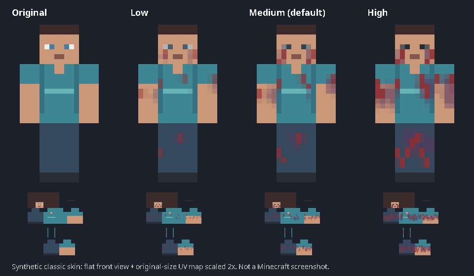
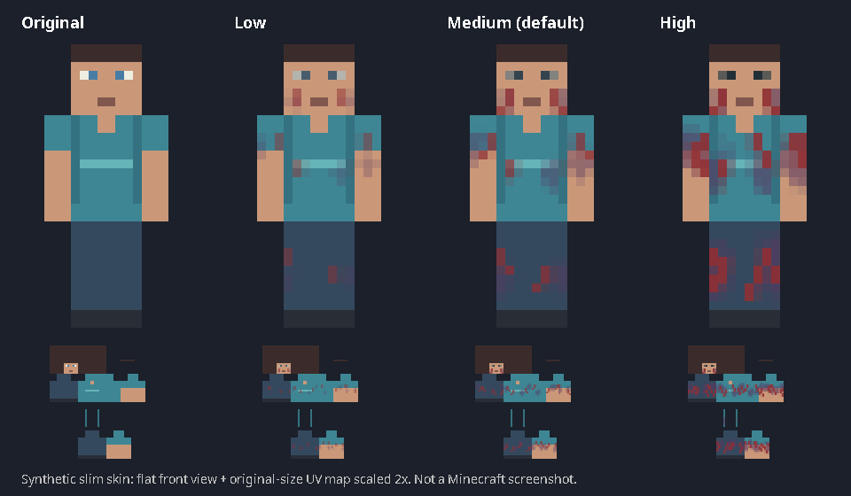

# InfectedMorph - Stage 1 (0.2.0-SNAPSHOT)

A standalone Maven plugin targeting Purpur 26.2 and Java 25. No client mods or ChunkVote dependency.
Stage 1 generates a recognizable infected variant of the player's current 64x64 skin.
**Preview-only is the default.** The optional Java profile display is experimental and disabled by default.
Bedrock skin transformation is not implemented, and Java skin visibility on Bedrock is unverified.

## Commands and permissions

| Command | Permission | Behavior |
| --- | --- | --- |
| `/infect stage1` | `infectedmorph.stage1` (default: op) | Download the current skin, generate a PNG preview and optionally publish/apply a Java profile. |
| `/infect normal` | `infectedmorph.normal` (default: true) | Cancel pending work and restore the original texture if InfectedMorph still owns the applied texture. |
| `/infect status` | `infectedmorph.status` (default: true) | Show stage, task state, intensity, eye mode, client detection, server versions and limitations. Also available in the console. |

Permissions use Bukkit's standard `hasPermission`, including LuckPerms. Example:

```text
lp user <name> permission set infectedmorph.stage1 true
```

`PREVIEW_READY` means a PNG was generated, **not** that a skin transformation occurred. The stage stays `NORMAL`.
Only the opt-in Java backend can set `JAVA_PROFILE_APPLIED`; that reports a server profile update, not client rendering confirmation.
`RESTORE_REQUIRED` explicitly reports an uncertain profile after a failed update/rollback.

## Visible infection and intensity

```yaml
stage1:
  enabled: true
  infection-intensity: medium
  eyes:
    mode: auto
    pixels: ['1,4', '2,4', '5,4', '6,4']
java-display:
  enabled: false
```

| Intensity | Appearance |
| --- | --- |
| `low` | Small, translucent bruises and short scratches; subtle infection. |
| `medium` | Clearly visible irregular bruises, longer cuts and darker eyes; the default. |
| `high` | More lesions, larger bruises and stronger color contrast for cinematic scenes. |

Invalid intensity values produce an English warning and fall back to `medium`. Missing values in older configs also use `medium`.
Configuration is read at startup; restart the server after editing it. Existing config files are preserved: add the new keys manually
or back up and regenerate the config. All new defaults are included in the bundled `config.yml`.

The generator copies original ARGB pixels, applies localized masks and preserves every alpha value, including hidden RGB data
in fully transparent pixels. Scratches and cuts affect face cheeks, torso, arms and legs, including side/back surfaces and existing
outer-layer pixels. Bruises have irregular edges. Each mask is clipped to its own UV rectangle; caps, unused slim columns,
the upper head/hairline and central nose/mouth pixels are preserved. There is no global recoloring, resizing or geometry change.
The same UUID, source pixels, model, intensity and eye settings reproduce the same result.

Original clothes, hair and most colors remain recognizable. Marks on covered limbs/torso appear as stains or cuts on clothing;
this is a UV heuristic, not semantic clothing or face recognition. Unusual hair covering cheek pixels cannot always be identified.
Contrasting hat/hair overlay pixels on the face are protected. Inspect your actual skin before filming.
Only standard **64x64 PNG**, classic/wide and slim models are supported. Legacy 64x32, HD, persona and custom geometry are rejected.

### Eye settings

- `auto`: search multiple rows for paired contrasting features with a consistent surrounding color. Ambiguous/unrecognized faces
  are left without eye darkening. The detector does not assume all custom skins have eyes at the standard coordinates.
- `custom`: darken only the configured `pixels`, each an `x,y` pair local to the front face (0..7).
  This supports asymmetric, shifted and nonhuman eyes. It is a global setting, so use it only for a known compatible skin layout.
- `off`: disable eye darkening. Invalid eye settings warn and disable it safely.

Darkening grows with intensity. The legacy `stage1.darken-standard-eyes: false` opt-out is still honored if present.
The custom coordinates are used only in custom mode; the default coordinate list is an example, not an assumption made by auto mode.

## Generated samples

The samples use original synthetic fixtures, not downloaded player skins. Each model has its original PNG and low/medium/high PNGs:
[preview files and reproduction instructions](docs/previews/README.md).




The sheets show a flat, composited front view and the UV map, scaled with nearest-neighbor sampling.
They are **not Minecraft screenshots** and do not verify client display, lighting or armor interaction.

## Build and artifact

Use **JDK 25** and Maven 3.9.x. Check both `java -version` and `mvn -version`, then run:

```sh
mvn package
```

The packaged plugin is `target/InfectedMorph-0.2.0-SNAPSHOT.jar`. Gson is bundled and relocated; Purpur API is `provided`.
The official Purpur repository and Maven Central must be reachable. For managed proxies, configure Maven's proxy and trusted CA;
never disable TLS verification. The local cloud proxy previously blocked Purpur with HTTP 403, so the complete build also runs
in [GitHub Actions](https://github.com/antonibielanski5650/InfectedMorph/actions) on Java 25.
Successful runs provide **InfectedMorph-test-jar** and **InfectedMorph-stage1-previews** downloads.
The updated [successful Java 25 build](https://github.com/antonibielanski5650/InfectedMorph/actions/runs/38688114241)
passed all 27 tests: [new JAR ZIP](https://github.com/antonibielanski5650/InfectedMorph/actions/runs/38688114241/artifacts/11950574431)
and [preview ZIP](https://github.com/antonibielanski5650/InfectedMorph/actions/runs/38688114241/artifacts/11950374762).
See [verification notes](docs/verification.md) for what was actually checked and what remains unverified.

## Local Purpur testing

1. Create a separate local test server directory. Download Purpur **26.2** from the [official downloads](https://purpurmc.org/downloads).
   Run it on Java 25 with `java -Xms1G -Xmx2G -jar purpur.jar nogui`, read/accept its EULA yourself, then stop the server.
2. Place the packaged JAR in `plugins/`. Add compatible Geyser-Spigot/floodgate versions and optionally LuckPerms.
   Restart fully; do not use `/reload`. Check the English startup diagnostics and `PREVIEW_ONLY`.
3. Join with a Java account using a standard 64x64 skin. Grant the permission and run `/infect status`, then `/infect stage1`.
   Confirm `PREVIEW_READY` with stage `NORMAL` and a message stating your skin has not changed.
   Compare `plugins/InfectedMorph/previews/<UUID>/original.png` with `stage1.png`.
4. Try low, medium and high, restarting between configuration changes. Test classic and slim skins, transparent outer layers,
   shifted eyes and `auto`/`custom`/`off`. Inspect face, torso, all limb sides and the outer layer before enabling live display.
5. `/infect normal` must cancel pending work. Repeated `stage1`, exit/rejoin, missing permissions, invalid configuration,
   unavailable textures and blocked network access must not falsely report a transformation.
6. For **experimental Java display only**, stop the server, obtain a [MineSkin API key](https://docs.mineskin.org/docs/guides/getting-started/),
   set the server process environment variable `INFECTEDMORPH_MINESKIN_API_KEY`, and enable `java-display.enabled`.
   This sends generated skins to an external service as `unlisted` (not private). Never commit or log the key.
   Allow HTTPS to `api.mineskin.org` and `textures.minecraft.net`; configure JVM networking if your server requires a proxy.
7. After restarting, test profile application from F5 and a second Java observer, tab list, death/respawn and world changes.
   Run `normal` and verify restoration of the original skin/model/cape. Test invalid keys, cooldown/HTTP 429,
   disconnect during generation, restart, and interaction with other skin/nickname plugins.
8. Connect a Bedrock client through local Geyser-Spigot/floodgate. Status should report `BEDROCK`; Stage 1 must explain that
   Bedrock skin transformation is not implemented and remain `NORMAL`. Separately inspect any Java player's changed skin
   from Bedrock, recording actual client/platform/plugin versions. This remains unverified, not supported by assertion.

## Safety and lifecycle behavior

- No movement, player scale, attributes, effects, inventory or extra body parts are changed. Stages 2-5, animated models,
  the ten future monster types and the separate Fuse mutation remain unimplemented.
- Player/Bukkit calls stay on the main thread. Downloads, generation, file writes and MineSkin publication use one worker
  and a queue of at most eight jobs. Network response limits, timeouts and disabled redirects are preserved.
- Only `textures.minecraft.net/texture/<hash>` is accepted, upgraded to HTTPS. PNG dimensions are checked before decoding.
  Missing textures cause an explicit error; the plugin does not substitute Steve/Alex or guess a Bedrock player's original skin.
- Cancellation, session identity, permission and source-profile checks prevent stale results from being applied after
  `normal`, reconnect or another skin change. Restoring only the original `textures` property preserves unrelated profile data.
- Another plugin's replacement skin is not overwritten. `EXTERNAL_SKIN_CHANGE` reports loss of texture ownership.
- State is session-local. Disconnect/disable attempts restoration; reconnect starts `NORMAL`. There is no persisted infection yet.
- Previews are atomically overwritten per UUID, remain after `normal` and are not served over HTTP. Administrators can remove
  `previews/` while the server is stopped. The in-memory signed-result cache holds at most 32 entries and resets on restart.
- The Java backend replaces the full signed `textures` property. A cape may disappear during infection; `normal` restores the
  original signed property. Payloads are not edited to attach a cape, and signatures are not forged.

## API references and compatibility boundaries

The original implementation checked the following official sources; dependencies remain pinned to the same API:

- [Purpur 26.2](https://github.com/PurpurMC/Purpur/blob/ver/26.2/README.md) and
  [published API build 2621](https://repo.purpurmc.org/snapshots/org/purpurmc/purpur/purpur-api/26.2.build.2621-stable/).
  Purpur includes Paper/Bukkit APIs. No open dependency range can silently upgrade to 26.3.
- [Paper Player](https://jd.papermc.io/paper/26.2/org/bukkit/entity/Player.html) and
  [PlayerProfile](https://jd.papermc.io/paper/26.2/com/destroystokyo/paper/profile/PlayerProfile.html): copy current profile,
  retain signed properties, apply through `setPlayerProfile`, preserve UUID.
- [Floodgate API](https://geysermc.org/wiki/floodgate/api/) and
  [GeyserApi](https://github.com/GeyserMC/Geyser/blob/master/api/src/main/java/org/geysermc/geyser/api/GeyserApi.java):
  optional public-API reflection for `isFloodgatePlayer(UUID)` and `connectionByUuid(UUID)`. API failures give `UNKNOWN`
  and block transformation. Detection targets Geyser-Spigot/floodgate installed on this server; proxy-only arrangements
  are not claimed as supported. Check [current protocol versions](https://geysermc.org/wiki/geyser/supported-versions/) before installation.
- [Geyser skin event](https://github.com/GeyserMC/Geyser/blob/master/api/src/main/java/org/geysermc/geyser/api/event/bedrock/SessionSkinApplyEvent.java):
  Bedrock needs a separate texture/session-refresh adapter, including its own appearance and observer testing.
- [MineSkin V2](https://docs.mineskin.org/docs/mineskin-api/generate-a-skin/) and
  [migration format](https://docs.mineskin.org/docs/guides/migrating-to-v2/): multipart upload, classic/slim variants,
  `skin.texture.data.value/signature`. This prototype serializes the documented synchronous endpoint with cooldown and no
  automatic retry; the service recommends queue endpoints for larger deployments. Responses are trusted over HTTPS,
  checked for payload/model validity and verified pixel-for-pixel against the generated image; signatures are not locally verified cryptographically.
- [Geyser resource packs](https://geysermc.org/wiki/geyser/packs/) and
  [GeyserModelEngine](https://github.com/GeyserExtensionists/GeyserModelEngine) illustrate separate Bedrock content integration.
  Stage 1 requires neither resource packs nor ModelEngine, and this project does not claim their future version compatibility.

`InfectionStage`, `Stage1SkinGenerator`, `SkinPublisher` and `AppearanceBackend` keep state, generation, publication and rendering
separate for later work. No production deployment, ChunkVote modifications or merge into `main` is part of this change.
